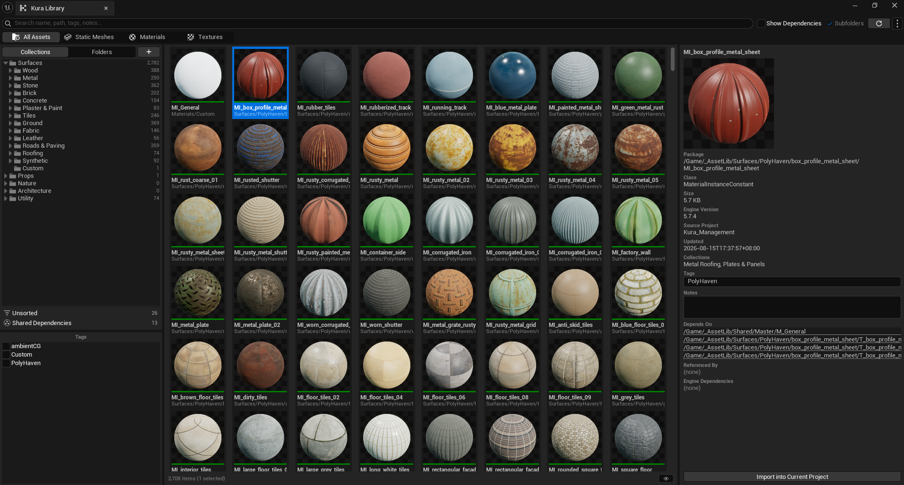
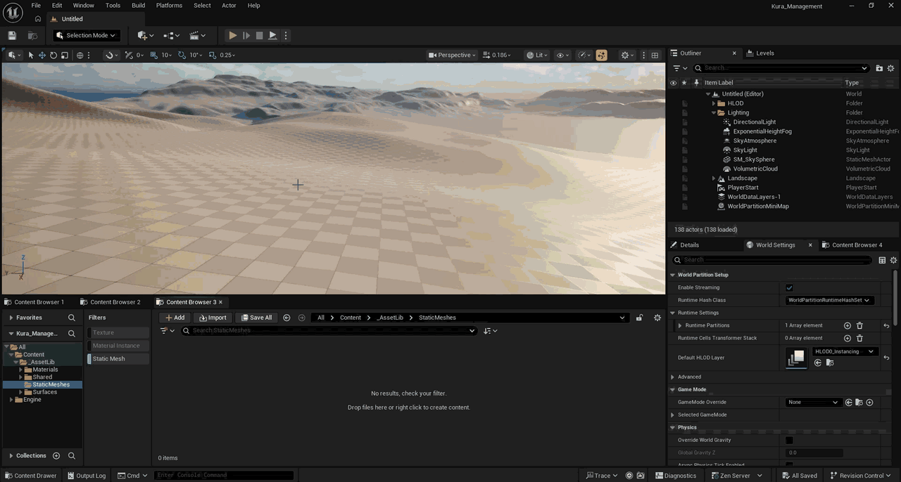
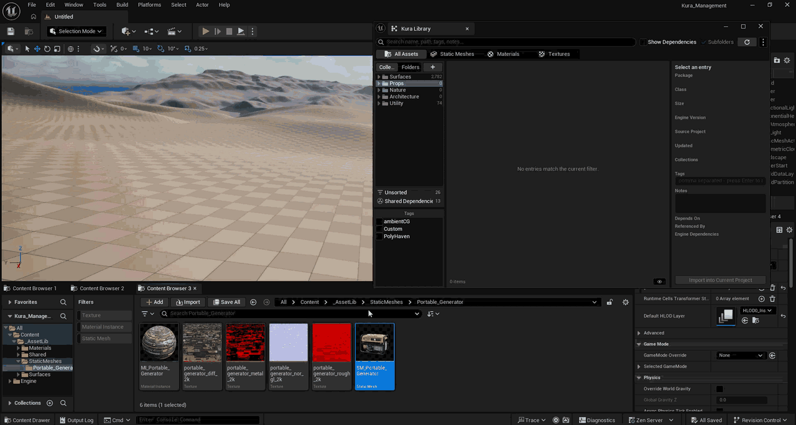

  

<h1 align="center">Kura</h1>

<b>A local asset library for Unreal Engine.</b> 
Send assets to your library, browse and organise them with thumbnails, tags and your own collections, then import them into any project with one click.

  
  
  

---

## 💡 Why Kura

Every UE artist ends up with a pile of old projects kept alive only because "the good chair is in there somewhere." Kura replaces that with one library folder on disk that every project can reach.

- **Send to Kura** — right-click anything in the Content Browser. It goes in *with its whole dependency chain*: materials, textures, material functions, all of it.
- **Browse it like a library** — thumbnails, folders and tag filters, with search across names, paths, tags and notes.
- **Organise it your way** — **Collections** are your own nested categories, stored as metadata only. File one asset into several of them, rename or reshuffle the whole tree whenever you change your mind — nothing on disk moves, no references break.
- **Import in one click** — the asset lands in your project at the path it always had, references intact. No FBX round-trip, no retexturing, no redirector cleanup, no hunting for the one material that didn't come along.
- **Pack it up and hand it over** — export any selection as a single `.kurapack` file; another Kura library imports it whole, tags and thumbnails included.
- **Nothing gets lost in the library** — deletes and overwrites inside the library go to a restorable archive, never straight off the disk.

## ⚙️ How it works

Kura keeps every library asset under a stable path — `/Game/_AssetLib/...` — that is identical in the library and in every project. Because `.uasset` files reference each other by package path, keeping the path stable means ingest and import are pure file copies with zero reference rewriting. The path is an asset's *identity*; its content hash is its *version*. Same path + same hash = deduplicated automatically. Same path + different hash = a conflict dialog, never a silent overwrite: uploading over a library asset archives the version it replaces, while importing over a project asset replaces that file outright — the archive guards library data, and the import dialog tells you so before you confirm.

## ✨ Features

- **Library browser panel** — class tabs (All Assets / Static Meshes / Materials / Textures), a Collections / Folders tree, and a thumbnail grid with multi-select. Three orthogonal controls: the tab picks *what kind*, the tree picks *which ones*, **Show Dependencies** reveals *what they are made of* — in Collections, the materials and textures the selected assets exclusively own, with shared masters staying out of the way; in Folders, simply the non-root files stored there. Tabs only ever filter the grid; the tree never changes shape, each row just reports how many assets *this* tab would list.
- **Collections** — your own nested classification, kept entirely in metadata: file an asset into as many collections as you like, rename or reorganise them at any time, and nothing on disk is touched. Anything you have uploaded but not filed waits under **Unsorted**, and a whole collection can be imported in one go.
- **Shared Dependencies** — a built-in view, pinned below the collection tree, listing everything referenced by two or more library assets: master materials, material functions, parameter collections, shared textures. It is computed from the reference graph, so it stays accurate on its own — there is nothing to file and nothing to maintain.
- **Search, tags and dependency links** — search across names, paths, tags and notes, filter by tag, and move around the tree from a details panel with clickable dependency / referenced-by links.
- **Ingest with a preview** — every upload shows New / Identical / Conflict per asset before anything is written; conflicts offer Update (old version archived) or Ignore, per item or in bulk. **Mark Dependencies as Roots** lists the auto-collected dependencies as library entries in their own right, so you never have to send a folder of textures twice.
- **Batch tagging** — tag a whole upload at once (e.g. `polyhaven`). Assets that arrive unchanged are skipped and keep their tags, so a shared master material never collects the tag of every pack that happens to use it; assets you update do take the new tags, on top of the ones they already had.
- **Shared masters stored once** — if two material instances use the same master material, the library keeps a single copy of it. Import both into a project and there is still one master — by design, not by luck.
- **Version guard** — assets saved by a newer engine are blocked from importing into an older one. There is an override, but expect it to help only within the same engine version: force an import across versions and the files land in your project unloadable.
- **Safe deletes** — nothing is hard-deleted: entries go to an archive and come back from **⋮ → Library → *Recently Deleted***. Deleting a material also offers to archive the textures it brought in when nothing else uses them, in the same restorable batch — never the assets you sent to Kura yourself — and **⋮ → Library → *Clean Unused Dependencies*** sweeps the whole library for leftovers.
- **`.kurapack` packages** — export any selection or folder (dependencies included) as a single file another Kura library can import.
- **Portable data layer** — per-asset JSON + thumbnails on disk; the database is a cache that can always be rebuilt (**⋮ → Library → *Verify Library***).
- **PBR Material Importer** — point it at a folder of downloaded PBR texture sets; it imports the textures with correct sRGB/compression settings, renames them consistently, and builds a Material Instance per set wired to your master material. It only touches the current project — nothing is sent to the library (**⋮ → *This Project* → *Build Material Instances from Textures***).

## 📥 Installation

| Requirement | |
|---|---|
| Engine | Unreal Engine 5.7 or 5.8 (Launcher build) |
| OS | Windows 10 / 11 |
| Projects | Blueprint-only and C++ projects both work |

1. Download the zip for your engine version from [Releases](https://github.com/Yashashin/Kura/releases). Plugin binaries are engine-specific; the wrong zip will not load.
2. Extract it into that engine's plugin folder, so that `...\UE_5.7\Engine\Plugins\Marketplace\Kura\Kura.uplugin` exists. Writing under `Program Files` needs administrator rights.
3. Start the editor, enable *Kura* in **Edit → Plugins** (its Python dependencies come along automatically) and restart when prompted. Then open **Tools → Kura Library** — on first run Kura asks where to keep your library and creates it for you.

Installing into the engine rather than into one project is deliberate: your library is meant to be reachable from *every* project. If you would rather not touch `Program Files`, put the `Kura` folder in `<YourProject>\Plugins\` instead — the zip ships precompiled binaries, so Blueprint-only projects work too, and you repeat it per project. Either way there is only one library.

## 🚀 Quick start

1. Open the panel: **Tools → Kura Library**. An empty library offers **Create _AssetLib Folder** right there (or **⋮ → This Project → Create _AssetLib Folder** any time) — that adds `/Game/_AssetLib` to your current project.
2. Move the assets you want to keep into it, using the Content Browser as usual.
3. Right-click them → **Send to Kura**. Review the upload preview, add a tag or two, pick a collection if you have one, confirm.
4. In any other project: open the panel, find the asset, right-click → **Import**. Done — the asset and everything it depends on land at the same paths they had.

A few things worth knowing early:

- Assets must sit under `/Game/_AssetLib` before upload — Kura validates that and never moves your files. Where they go underneath is up to you.
- Library entries can be Static Meshes, Materials, Material Instances and Textures. Whatever they reference — material functions, curves, textures — comes along on its own.
- **Folders are storage; collections are organisation.** A library folder is also the asset's path, so it is fixed at upload time. Reorganising happens in **Collections** — create, nest and re-file freely, put one asset in several collections, nothing on disk moves. Assets you have not filed yet wait under **Unsorted**.
- A layout that works well: one folder per asset holding its own textures, plus `Shared/Master`, `Shared/Functions`, `Shared/Parameters` and `Shared/Textures` for anything meant to be reused. **Keep categories out of the path** — a folder can never move once something references it, and categories are exactly what you change your mind about. Put in the path only what will never change: what an asset *is*, and, for a whole batch from one source, where it came from.
- Shared material masters and functions need no filing of their own. Whatever ends up referenced by two or more assets appears automatically under **Shared Dependencies**, below the collection tree.
- Never rename files inside the library folder by hand — that breaks references by definition. Rename in a project, re-upload, delete the old entry.

## 📦 Sharing assets: `.kurapack`

Right-click a selection of tiles → **Export as Package**, or a folder in the tree → **Export Folder as Package**. Either way the dependency closure comes along — including dependencies that live outside the folder you picked, so a package is never a broken subset.

The result is one self-contained file (zip layout, inspectable) carrying assets, metadata, tags and thumbnails. Another Kura user imports it via **⋮ → Library → Import Package**: identical entries are skipped, changed ones prompt — the same identity rules as everything else, so packages can overlap freely and shared masters still deduplicate. Every file is hash-verified on import, so a corrupted download aborts cleanly without touching the library.

A package also carries its collections, keyed by path rather than by id, so importing one files its assets into the same categories they had on the other side instead of dropping them all into *Unsorted*. The import dialog lets you take those collections, put everything into one collection of your own, or skip filing entirely.

<!-- TODO(release): attach Kura_Starter.kurapack to the release -->

### Something to import

Kura ships empty. Every [release](https://github.com/Yashashin/Kura/releases) has **`Kura_Starter.kurapack`** attached — 262 MB, eight surface materials (wood, brick, stone, concrete, metal, fabric, leather, ground) plus the master material, material functions and textures behind them. Import it with **⋮ → Library → Import Package** to walk the flow once and see a filled library: nine tiles, a collection tree, source tags to filter by, and the shared material functions listed under **Shared Dependencies**.

Beyond that, my own material library is published in full: **[2,680 CC0 materials across 33 packs](Docs/packs.md)**, from [Poly Haven](https://polyhaven.com) and [ambientCG](https://ambientcg.com), free to download and pick from. Import the starter pack first and every pack after it will skip the two dozen-odd assets they all share — deduplication doing its job in front of you. Those packs are a snapshot, published as-is and not maintained; the plugin is the thing I support.

## 🛠️ Configuration

Most of this lives in the panel (**⋮ → Settings**); the file behind it is `%APPDATA%\Kura\config.json`, hot-reloaded on every operation.

| Key | Default | Meaning |
|---|---|---|
| `library_root` | `<user>\Documents\Kura Library` | Where the library lives |
| `lib_prefix` | `/Game/_AssetLib` | Stable path prefix — set once, do not change on a populated library |
| `material_preview_mesh` | *(empty)* | Empty = UE's default material sphere; set a mesh path (e.g. `/Engine/EngineMeshes/SM_MatPreviewMesh_01`) to preview materials on that instead |
| `thumb_orbit_pitch` | `-11.25` | Thumbnail camera pitch |
| `thumb_orbit_yaw` | `-157.5` | Thumbnail camera yaw |
| `thumb_orbit_zoom` | `0` | Thumbnail camera distance offset (negative = closer) |
| `thumb_resolution` | `256` | Thumbnail PNG size, 32–2048 |

Thumbnail settings apply to thumbnails rendered from then on — the ones already in your library keep the look they were made with until you refresh them (tile right-click → **Refresh Thumbnail**). The three orbit values are narrower than they look: they steer **material** thumbnails only, and only while a material preview mesh is set — without one every class renders on its own thumbnail info and they are ignored (the Settings dialog greys them out to say so). Static meshes always keep the angle you gave them in the Content Browser.

The panel writes its own state into the same file. The first two are also editable in **Settings** (*Default Tile Size* and *Show Dependencies by Default*); the rest simply remember what you last did:

| Key | Default | Meaning |
|---|---|---|
| `show_dependencies` | `0` | Start with dependency-only entries hidden |
| `tile_size` | `150` | Tile size, 90–260, saved from the View Options slider |
| `sort_mode` | `0` | 0 = Name, 1 = Date Added, 2 = Size |
| `sort_ascending` | `1` | 1 = ascending (A-Z / oldest / smallest first), 0 = descending |
| `ingest_deps_as_roots` | `0` | Remembers the "Mark Dependencies as Roots" checkbox |
| `ingest_collection` | *(empty)* | Remembers the collection last picked in the upload preview |
| `collections_view` | `1` | 1 = left column shows Collections, 0 = Folders |

The PBR Material Importer keeps its own editable keyword table in `%APPDATA%\Kura\pbr_importer.json`.

## 📂 Where Kura keeps things

| Path | Contents |
|---|---|
| `<library root>\Content\_AssetLib\` | the assets themselves — a mirror of the `/Game/_AssetLib` tree (the folder name follows `lib_prefix`) |
| `<library root>\Meta\` | per-asset JSON + PNG thumbnail, parallel to the tree — the source of truth |
| `<library root>\Meta\collections.json` | the collection tree (names and nesting); which assets are in them lives in each asset's own JSON |
| `<library root>\library.db` | SQLite index; a cache, rebuildable any time with **Verify Library** |
| `<library root>\_archive\` | overwritten and deleted versions; it only grows, until you clear entries for good from **Recently Deleted** |
| `%APPDATA%\Kura\config.json` | settings |
| `%APPDATA%\Kura\pbr_importer.json` | PBR importer keyword table |

Back up the library root and you have backed up everything that matters — the two `%APPDATA%` files only hold preferences.

Kura writes into your *project* when you ask it to — **Import**, **Create _AssetLib Folder** and the PBR Material Importer — plus two small things while preparing an upload: it runs Fix Up Redirectors over `/Game/_AssetLib`, and it saves any asset in the selection that still has unsaved edits, so that what lands in the library is what is on disk. Nothing else touches project assets: browsing never writes, and thumbnail rendering applies a transient camera / preview-mesh override that is undone — dirty flag included — the moment the PNG is written.

## 🔄 Updating and uninstalling

- **Update:** close the editor, then replace the `Kura` plugin folder with the contents of the new zip, wherever you installed it (under `Program Files` that still needs administrator rights). A newer Kura reads your existing library as it is — there is nothing to migrate (next section).
- **Uninstall:** delete the `Kura` plugin folder — one per project, if that is how you installed it. Your library folder and `%APPDATA%\Kura` are left alone; remove them by hand if you want the data gone too.

## 🎮 Engine versions & library format

- **Supported engines: UE 5.7 and 5.8.** The policy is the current engine plus the previous one. Each release ships one zip per engine version — plugin binaries are never interchangeable between engine versions.
- **Assets only travel upward.** The starter pack and the asset packs are built with UE 5.7, so they import into 5.7 and 5.8 alike. That direction is an engine rule rather than a Kura one: a `.uasset` records the version that saved it, an older engine refuses to load a newer one, and Unreal has no "save as an older version". Kura's version guard catches this at import time and tells you why, instead of leaving you with an editor that fails to open the file.
- **Working across both versions?** The engine that uploads an asset sets that asset's floor — send it from 5.8 and only 5.8 can import it back, send it from 5.7 and either engine can. A mixed library is fine: the guard is per asset, and an import is blocked only when something in its dependency closure is too new. The simple rule is to upload from the older engine.
- **Library format:** each asset's metadata carries a `schema_version` (currently 2). New fields always arrive with a default and existing ones are never renamed or repurposed, so a newer Kura reads an older library as it is and upgrades entries one at a time as it rewrites them — never a bulk rewrite of a library it did not create. A `.kurapack` built by a newer Kura than yours is refused on import, with a message telling you to update. The same holds for a whole library: if you open one written by a newer Kura, it stays readable — browse it, import from it — but any change to it is refused rather than risk dropping fields this build does not know about. *Verify Library* lists the entries this applies to.

## ⚠️ Known limitations

- **Windows only; UE 5.7 and 5.8 only.** Older engines are not supported.
- **Uploadable types:** Static Mesh, Material, Material Instance, Texture (2D / Cube / Array). Skeletal Meshes, Blueprints, Niagara systems, levels and animation assets cannot be library entries. Dependency-only classes that a supported asset references (material functions, curves, …) come along fine and show up under the **All Assets** tab.
- **Content from other plugins is blocked.** Only `/Game` (copied into the library) and `/Engine` (recorded in metadata, not copied) are supported. Anything depending on `/Fab/` or another plugin mount — Fab / Quixel Bridge content, plugins that ship content — is rejected with the offending references listed. Move what you need into `/Game` first.
- **One library at a time.** Kura points at a single `library_root`; switching means changing the setting.
- **No multi-user locking.** A library on a NAS or a synced folder can be shared, but Kura assumes a single writer — concurrent uploads from two machines are not protected against.
- **Not version control.** `_archive` keeps whatever you overwrite or delete **in the library**, one batch per action. That is a safety net you can restore from, not a history you can navigate.
- **Renaming inside the library folder breaks it by design** — the path *is* the identity, so never rearrange the library in Explorer. Kura can rename or move a library folder for you (right-click it in the **Folders** tree), but only while nothing inside it is referenced by another entry — for an asset stored next to its own textures, that means almost never. To relocate something that *is* referenced: move it in a project, send it to Kura again, then delete the old entries. To re-file assets for browsing, use collections; they change nothing on disk.

## ❓ FAQ

**How is this different from Migrate?**
Migrate is a one-shot copy between two projects: you still have to own the source project, remember which one it was, find the asset inside it, and clean up afterwards. Kura is the library Migrate never came with — one folder, browsable with thumbnails and tags, that every project can pull from. Underneath it is the same principle (copy the files, keep the paths), automated, with deduplication and versioning on top.

**How is it different from Fab or Quixel Bridge?**
Those are storefronts for *their* content. Kura is for *yours* — what you made, what you bought elsewhere, what you downloaded as CC0.

**Can I upload assets I bought on Fab or the Marketplace?**
If they live under `/Game`, Kura will take them — it does not inspect licences. Whether you may keep them in a personal library, and whether you may put them in a `.kurapack` you hand to someone else, is between you and that asset's licence. Most store licences allow reuse across your own projects; essentially none allow redistribution. Content that lives in a plugin mount is blocked outright (see limitations).

**Can my team share one library?**
Technically yes — put it on a share and point everyone at it. There is no locking or permissions, so treat it as read-mostly: one person curates and uploads, everyone else imports. For a real team workflow, exporting `.kurapack` files into whatever file sharing you already use is safer.

**Two of my projects have a different `M_Wood` at the same path. Now what?**
Kura reports a version conflict, because the path is the identity. If they really are different materials, rename one of them in its project and upload again — you'll end up with both. If one is simply the newer version, choose *Update*; the old one goes to `_archive`.

**A thumbnail is missing or blurry.**
Right-click the tile → **Refresh Thumbnail**. It needs the asset to exist in the *current* project at its library path with matching content, so import it first, then refresh.

## ❤️ Support

Kura is free, and there is no paid version planned. If it saves you time and you feel like it, you can [buy me a coffee](https://ko-fi.com/yukio1024).

What that buys: nothing. It is a thank-you, not a transaction — no priority support, no influence on what gets built, no supporter-only features. Issues are read the same way whether you have donated or not.

## 📄 License

[MIT](LICENSE) — © 2026 Yashashin.
